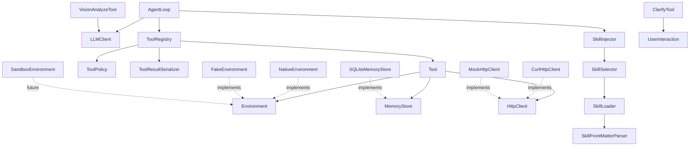

# OGK-Agent
# PHASE 3 — OVERALL SYSTEM DESIGN

**Phiên bản:** 1.2  
**Trạng thái:** Design Draft — Chờ khóa thiết kế  
**Ngôn ngữ triển khai:** C++23  
**Backend:** Ollama API  
**Repository:** https://github.com/tuanholmestar/OGK-Agent

---

## 1. Mục đích tài liệu

Tài liệu này mô tả thiết kế tổng thể Phase 3 của OGK-Agent, bao gồm:

- Tool System.
- ToolRegistry và ToolPolicy.
- Environment.
- Infrastructure dùng chung.
- Skill System.
- Cấu trúc thư mục.
- Chiến lược kiểm thử.
- Các quyết định thiết kế và trạng thái phê duyệt.

Đây là tài liệu thiết kế, không phải tài liệu hướng dẫn sử dụng hay đặc tả chi tiết từng API.

Các chữ ký hàm, JSON Schema, error mapping và test contract sẽ được trình bày trong tài liệu Interface Specification riêng.

### Nguyên tắc

1. Tuân thủ kiến trúc Phase 1 và các interface Phase 2 đã đóng băng.
2. Không thay đổi public interface Phase 2 nếu không có phê duyệt.
3. Không để Tool phụ thuộc AgentLoop.
4. Không để Skill System phụ thuộc trực tiếp AgentLoop.
5. Tách biệt business logic và infrastructure.
6. Ưu tiên YAGNI, RAII và smart pointer.
7. Mọi quyết định phải có trạng thái và nguồn xác định.

---

## 2. Phạm vi Phase 3

### 2.1. Tool System

Xây dựng hệ thống cho phép:

- Đăng ký Tool tại runtime.
- Tra cứu Tool theo tên.
- Quản lý vòng đời Tool.
- Kiểm soát quyền truy cập.
- Kiểm tra arguments trước khi thực thi.
- Chuẩn hóa kết quả và lỗi.

### 2.2. Skill System

Xây dựng hệ thống cho phép:

- Scan thư mục `skills/`.
- Đọc nội dung Markdown.
- Phân tích metadata.
- Chọn Skill theo task.
- Hỗ trợ nhiều Skill.
- Chuẩn bị nội dung để AgentLoop inject vào system prompt.

### 2.3. Environment

Cung cấp abstraction cho thao tác với hệ thống:

- Đọc file.
- Ghi file.
- Đọc dữ liệu nhị phân nội bộ.
- Kiểm tra quyền truy cập đường dẫn.
- Thực thi process.

Phase 3 triển khai NativeEnvironment ở phạm vi tối thiểu. SandboxEnvironment chỉ được thiết kế cho khả năng mở rộng, không tuyên bố đã triển khai sandbox hoàn chỉnh.

---

## 3. Tool System

### 3.1. Tool Interface

Mọi Tool tuân theo một interface thống nhất, gồm:

- `name()`: trả về tên duy nhất.
- `description()`: mô tả chức năng.
- `parameters()`: cung cấp JSON Schema.
- `execute(arguments)`: thực thi và trả về ToolResult.

Tool không được biết AgentLoop hoặc Harness tồn tại.

### 3.2. ToolResult

ToolResult biểu diễn kết quả thực thi theo cấu trúc thống nhất.

**Success:**
- Trạng thái thành công.
- Dữ liệu kết quả.

**Error:**
- Error code.
- Error message.
- Field path nếu lỗi liên quan đến input cụ thể.

Các error code:

| Code | Ý nghĩa |
|---|---|
| `INVALID_ARGUMENTS` | Arguments không hợp lệ |
| `PERMISSION_DENIED` | Không được phép thực hiện |
| `RESOURCE_NOT_FOUND` | Không tìm thấy Tool hoặc tài nguyên |
| `EXECUTION_FAILED` | Thực thi thất bại |
| `TIMEOUT` | Quá thời gian cho phép |
| `INTERNAL_ERROR` | Lỗi nội bộ |
| `INTERACTION_UNAVAILABLE` | Không có kênh tương tác người dùng |

Không đưa exception message hoặc thông tin kỹ thuật nhạy cảm trực tiếp cho LLM.

### 3.3. Danh sách Tool

| Tool | Implementation | Chức năng |
|---|---|---|
| `exec` | ExecTool | Thực thi process |
| `read_file` | FileTool (Read) | Đọc file văn bản |
| `write_file` | FileTool (Write) | Ghi file văn bản |
| `web_search` | WebSearchTool | Tìm kiếm thông tin |
| `memory_save` | MemoryTool (Save) | Lưu memory |
| `memory_search` | MemoryTool (Search) | Truy vấn memory |
| `calculator` | CalculatorTool | Tính biểu thức |
| `todo_list` | TodoListTool | Quản lý danh sách công việc |
| `vision_analyze` | VisionAnalyzeTool | Phân tích hình ảnh |
| `clarify` | ClarifyTool | Yêu cầu người dùng làm rõ |

Có 10 Tool operations và 8 implementation classes.

FileTool và MemoryTool có thể dùng chung implementation class nhưng phải được khởi tạo thành các instance riêng, mỗi instance đại diện cho một operation và một tên Tool duy nhất.

### 3.4. ToolRegistry

ToolRegistry chịu trách nhiệm:

- Runtime registration.
- Lookup theo tên.
- Quản lý ownership.
- Factory/Registry Pattern.
- Liệt kê Tool.
- Lấy danh sách ToolDefinition.
- Thực thi Tool theo tên.
- Unregister Tool.

Registry sở hữu Tool bằng `std::unique_ptr`.

Không bảo đảm pointer hoặc reference còn hợp lệ sau khi unregister. Các module phía trên nên thao tác theo tên Tool thay vì lưu raw pointer lâu dài.

Lỗi cấu hình Registry, chẳng hạn đăng ký trùng tên hoặc factory không hợp lệ, được xử lý bằng exception.

Lỗi trong quá trình chạy Tool được chuyển thành ToolResult.

### 3.5. ToolPolicy

ToolPolicy quản lý quyền truy cập theo tên Tool.

**Quy tắc chính thức:**

1. Có Allow list và Deny list.
2. Deny-over-Allow: Deny luôn ưu tiên hơn Allow.
3. Allow list mặc định rỗng.
4. Tool không nằm trong Allow list bị từ chối.
5. Tool nằm trong Deny list luôn bị từ chối, kể cả khi cũng nằm trong Allow list.

Do đó, Registry mới tạo mặc định từ chối tất cả Tool cho đến khi được cấu hình Allow.

`get_definitions()` và `execute()` sử dụng cùng một Policy instance để tránh tình trạng Tool được cung cấp cho LLM nhưng lại không được phép thực thi.

`get_definitions()` chỉ trả về những Tool được Policy cho phép, sắp xếp ổn định theo tên.

### 3.6. Thứ tự xử lý execute()

Thứ tự xử lý bắt buộc:

1. Tìm Tool theo tên.
2. Nếu không tồn tại, trả về `RESOURCE_NOT_FOUND`.
3. Kiểm tra ToolPolicy.
4. Nếu không được phép, trả về `PERMISSION_DENIED`.
5. Validate arguments theo JSON Schema.
6. Nếu không hợp lệ, trả về `INVALID_ARGUMENTS`.
7. Thực thi Tool.
8. Trả về ToolResult.

Không được validate hoặc thực thi Tool trước khi kiểm tra quyền truy cập.

### 3.7. JSON Schema Validation

Registry thực hiện validation trước khi gọi Tool.

Hệ thống chỉ hỗ trợ một tập con JSON Schema, không tuyên bố tuân thủ toàn bộ tiêu chuẩn.

Các thuộc tính hỗ trợ:

- `type`
- `properties`
- `required`
- `enum`
- `additionalProperties`
- `items`
- `minimum`
- `maximum`
- `minLength`
- `maxLength`

Validation object và array phải hỗ trợ đệ quy.

Quy tắc kiểu dữ liệu:

- `integer` chỉ nhận JSON integer.
- `number` nhận integer hoặc floating-point.
- Không tự động ép kiểu.
- `5.0` không được chấp nhận như integer.

Lỗi validation cần có field path theo JSON Pointer, ví dụ:

- `/arguments/0`
- `/metadata/source`

### 3.8. ToolResultSerializer

ToolResultSerializer chuyển ToolResult thành JSON compact để đưa vào conversation history.

Giới hạn mặc định: 8 KiB.

Không cắt trực tiếp chuỗi JSON đã serialize vì có thể tạo JSON không hợp lệ.

Khi dữ liệu vượt giới hạn, serializer tạo envelope JSON hợp lệ, chứa trạng thái truncated, kích thước ban đầu và preview được cắt tại ranh giới UTF-8.

Giới hạn 8 KiB không thay thế việc quản lý context/token budget của AgentLoop.

---

## 4. Environment

### 4.1. Kiến trúc

Namespace: `ogk::env`.

Các thành phần:

- `Environment`: abstract interface.
- `NativeEnvironment`: thao tác với hệ thống thực.
- `FakeEnvironment`: phục vụ unit test.
- `SandboxEnvironment`: thiết kế cho khả năng mở rộng trong tương lai.

### 4.2. NativeEnvironment

Linux là nền tảng được hỗ trợ đầy đủ trong phạm vi Phase 3.

Windows có thể hỗ trợ một số thao tác file; process execution không được cam kết tương đương Linux.

NativeEnvironment không phải sandbox hoàn chỉnh.

### 4.3. Process Execution

Tool `exec` không nhận một chuỗi shell tùy ý làm command.

Executable và arguments phải được truyền riêng.

Các giới hạn thiết kế:

- Executable phải được kiểm tra theo allowlist.
- Đường dẫn executable được chuẩn hóa trước khi so sánh.
- Không tin executable name hoặc PATH do input không đáng tin cậy cung cấp.
- Timeout mặc định 10 giây.
- Timeout tối đa 60 giây.
- stdout tối đa 1 MiB.
- stderr tối đa 1 MiB.
- Có cờ `truncated` khi output bị giới hạn.

Khi timeout hoặc vượt giới hạn output, process phải được kết thúc và thu hồi tài nguyên đúng cách.

Trên Linux cần xử lý process group, không chỉ process cha.

### 4.4. File Operations

- `read_file` chỉ đọc văn bản UTF-8.
- UTF-8 không hợp lệ dẫn đến lỗi `EXECUTION_FAILED`.
- Dữ liệu nhị phân chỉ được đọc qua API nội bộ phục vụ VisionAnalyzeTool.
- `write_file` mặc định không overwrite.
- Không tự tạo parent directory.
- Đường dẫn phải được chuẩn hóa và kiểm tra phạm vi truy cập.
- Cần xử lý `..` và symlink.

TOCTOU vẫn là giới hạn cần ghi nhận; không tuyên bố NativeEnvironment cung cấp bảo mật sandbox hoàn chỉnh.

---

## 5. Infrastructure

### 5.1. HttpClient

Thiết kế abstraction:

- `HttpClient`: interface.
- `CurlHttpClient`: implementation dùng libcurl.
- `MockHttpClient`: phục vụ test.

OllamaClient và WebSearchTool sử dụng HttpClient.

Giữ constructor hiện tại của OllamaClient và bổ sung overload nhận `std::unique_ptr<HttpClient>` để dependency injection.

Không thay đổi public interface của LLMClient.

### 5.2. MemoryStore

Thiết kế abstraction:

- `MemoryStore`: interface.
- `SQLiteMemoryStore`: implementation.

MemoryTool không truy cập SQLite trực tiếp.

SQLite sử dụng parameterized query.

`memory_search` sử dụng LIKE trong phạm vi MVP, không bắt buộc FTS5.

Dữ liệu:

- `memory_id`: int64.
- `created`: Unix timestamp UTC seconds.

### 5.3. Web Search

Backend: SearXNG.

Yêu cầu:

- Endpoint cấu hình từ bên ngoài.
- Không hardcode public instance.
- Hướng dẫn bật JSON output format.
- Có timeout.
- Giới hạn số kết quả.
- Giới hạn độ dài nội dung.

Kết quả tìm kiếm là dữ liệu không đáng tin cậy, không được coi là chỉ thị dành cho Agent.

---

## 6. Skill System

### 6.1. Thành phần

- `Skill`
- `SkillLoader`
- `SkillFrontMatterParser`
- `SkillSelector`
- `SkillInjector`
- `LoadReport`

Skill System không phụ thuộc trực tiếp AgentLoop.

### 6.2. SkillLoader

SkillLoader scan thư mục `skills/`, đọc Markdown và quản lý danh sách Skill.

Thứ tự scan phải ổn định.

Nếu xảy ra lỗi parse một Skill, Loader ghi nhận lỗi trong LoadReport và tiếp tục xử lý các Skill còn lại.

Nếu trùng tên Skill, giữ Skill xuất hiện đầu tiên và ghi nhận các bản trùng là lỗi.

### 6.3. Bộ Skill mặc định

Chốt thống nhất ba file:

1. `file_management.md`
2. `web_research.md`
3. `problem_solving.md`

Đây là bộ tên dùng trong cấu trúc thư mục, tài liệu thiết kế và test.

Không dùng lẫn với bộ tên cũ `task_planner.md`, `error_recovery.md`, `research_assistant.md`.

Tên Skill không phải yêu cầu bắt buộc được giảng viên chỉ định; đây là quyết định tổ chức của dự án.

### 6.4. Front Matter

Sử dụng parser cho một tập con YAML:

- `name`: chuỗi một dòng.
- `description`: chuỗi một dòng.
- `keywords`: danh sách `- item`.

Không hỗ trợ nested object, multiline scalar, anchor, alias hoặc cú pháp YAML nâng cao.

### 6.5. Skill Selection

Quy tắc matching:

- Lowercase ASCII.
- Delimiter gồm whitespace, punctuation, `_`, `-`.
- Giữ nguyên byte UTF-8 tiếng Việt.
- Không chuẩn hóa Unicode.
- Không loại bỏ dấu tiếng Việt.
- Từ có dấu và không dấu không được xem là tương đương.

Scoring:

- Phrase match: 2 điểm.
- Single-word match: 1 điểm.
- Mỗi keyword chỉ được tính tối đa một lần.
- Threshold tối thiểu: 1 điểm.
- Sắp xếp score giảm dần; nếu bằng điểm, sắp xếp theo tên Skill tăng dần.

**Quy tắc phrase overlap:**

Khi một phrase keyword được match, các single-word keyword nằm bên trong phrase đó của cùng Skill không được cộng điểm thêm.

Ví dụ:

Skill có keywords:

- `web search`
- `search`

Task chứa cụm `web search`.

Kết quả:

- `web search`: 2 điểm.
- `search`: 0 điểm bổ sung.
- Tổng: 2 điểm, không phải 3 điểm.

Quy tắc này chỉ áp dụng cho keyword đơn thuộc chính Skill đang được tính điểm.

### 6.6. Skill Injection

Giới hạn injection mặc định: 16 KiB.

- Xử lý Skill theo thứ tự score giảm dần và tên tăng dần.
- Chỉ inject nguyên vẹn một Skill nếu còn đủ ngân sách.
- Không cắt nội dung Markdown giữa chừng.
- Skill vượt ngân sách bị bỏ qua và ghi nhận trong danh sách budget-excluded.
- Skill đơn lẻ lớn hơn ngân sách cũng bị bỏ qua.

### 6.7. LoadReport

LoadReport chứa:

- Danh sách Skill load thành công.
- Danh sách lỗi `LoadIssue`.
- Danh sách warning `LoadIssue`.

Mỗi LoadIssue có path và reason.

---

## 7. Tool-specific Design

### 7.1. CalculatorTool

Hỗ trợ:

- `+`, `-`, `*`, `/`, `%`, `^`.
- Số nguyên và số thực.
- Unary `+`, `-`.
- Dấu ngoặc.
- `^` kết hợp phải.

Cần quy định rõ precedence, bao gồm trường hợp `-2^2`.

Không sử dụng `eval`.

Có giới hạn độ dài biểu thức và độ sâu parser.

Xử lý chia cho 0, modulo không phải số nguyên và kết quả NaN/Infinity.

### 7.2. TodoListTool

Các operation:

- `add`
- `list`
- `complete`
- `remove`

MVP lưu trữ trong memory.

Schema khai báo đầy đủ các property được phép; validation điều kiện bắt buộc theo operation được thực hiện bên trong Tool.

### 7.3. VisionAnalyzeTool

- Inject một LLMClient riêng.
- Có thể sử dụng model khác Agent model.
- Không sử dụng conversation history của Agent.
- Kiểm tra kích thước và định dạng ảnh.
- Kiểm tra khả năng vision của model trước khi sử dụng.

### 7.4. ClarifyTool

Sử dụng abstraction `UserInteraction`.

Không gọi trực tiếp `cin` hoặc `cout`.

Nếu không có interaction provider, trả về `INTERACTION_UNAVAILABLE`.

---

## 8. Cấu trúc thư mục đề xuất

```text
OGK-Agent/
├── CMakeLists.txt
├── include/
│   └── ogk/
│       ├── llm/
│       ├── tools/
│       ├── env/
│       ├── skills/
│       ├── infrastructure/
│       └── common/
├── src/
│   ├── llm/
│   ├── tools/
│   ├── env/
│   ├── skills/
│   └── infrastructure/
├── skills/
│   ├── file_management.md
│   ├── web_research.md
│   └── problem_solving.md
├── tests/
│   ├── unit/
│   └── integration/
├── docs/
│   ├── architecture.md
│   ├── phase-2-interface-spec.md
│   ├── phase-2-handover.md
│   ├── phase-3-overall-design.md
│   └── adr/
└── README.md
```

Cấu trúc trên là đề xuất tổ chức module. Khi triển khai cần giữ tương thích với cấu trúc thực tế của repository.

---

## 9. Dependency Graph



Nguyên tắc dependency:

- Tool không phụ thuộc AgentLoop.
- Skill System không phụ thuộc AgentLoop.
- AgentLoop chỉ sử dụng abstraction.
- Environment được inject vào Tool.
- MemoryTool sử dụng MemoryStore abstraction.
- HTTP consumer sử dụng HttpClient abstraction.

---

## 10. Testing Strategy

### 10.1. Tool Tests

Mỗi Tool phải có:

- Test input hợp lệ.
- Test input không hợp lệ.
- Test một trường hợp thất bại đặc thù.

### 10.2. Registry Tests

Kiểm thử:

- Runtime registration.
- Duplicate registration.
- Lookup.
- Unregister.
- Policy.
- Deny-over-Allow.
- Default-deny.
- JSON Schema validation.
- Exception handling.
- Tool không tồn tại.

### 10.3. Environment Tests

- Unit test dùng FakeEnvironment.
- Linux integration test dùng NativeEnvironment.
- Kiểm thử file, process, timeout và output limit.

### 10.4. Infrastructure Tests

- Mock HTTP cho Ollama và SearXNG.
- SQLite integration test với temporary database.
- Serializer JSON hợp lệ và xử lý truncation.

SearXNG integration test thực tế nếu có môi trường phù hợp. Nếu không chạy, phải ghi `NOT RUN`, không ghi `PASS`.

### 10.5. Skill Tests

Kiểm thử:

- Front matter parsing.
- Invalid Markdown metadata.
- Duplicate Skill.
- Keyword matching.
- Phrase matching.
- Phrase overlap.
- Score tie-break.
- Injection budget.
- LoadReport.

### 10.6. Regression

Toàn bộ Phase 2 tests phải tiếp tục PASS.

---

## 11. Design Patterns

| Pattern | Vị trí | Mục đích |
|---|---|---|
| Strategy | Tool/Policy và các abstraction phù hợp | Thay thế hành vi qua interface |
| Registry/Factory | ToolRegistry | Đăng ký và quản lý Tool |
| Dependency Injection | Environment, HttpClient, MemoryStore | Giảm coupling và hỗ trợ test |
| Observer/Hook | AgentLoop ở Phase 4 | Cho Harness quan sát step |
| Template Method | AgentLoop ở Phase 4 | Định nghĩa skeleton ReAct |
| Strategy | Evaluator ở Phase 5 | Thay thế cách đánh giá |

Phase 3 tập trung Tool và Skill. Không triển khai AgentLoop hoặc Harness trong phạm vi này.

---

## 12. Decision Register

### 12.1. Quy ước

Chỉ sử dụng ba trạng thái:

- `Approved`: đã được phê duyệt.
- `Proposed`: đang đề xuất, chưa được phê duyệt.
- `Deferred`: chủ động hoãn sang giai đoạn sau.

Nguồn quyết định:

- `Đề bài`: yêu cầu trực tiếp từ giảng viên.
- `Người dùng`: lựa chọn được người thực hiện xác nhận.
- `Thiết kế`: đề xuất kỹ thuật của nhóm thiết kế.

Không dùng `Required` làm trạng thái.

### 12.2. Các quyết định đã xác nhận trong phạm vi tài liệu hiện tại

| ID | Quyết định | Trạng thái | Nguồn |
|---|---|---|---|
| P3-D01 | Tool có interface thống nhất | Approved | Đề bài |
| P3-D02 | ToolRegistry hỗ trợ runtime registration | Approved | Đề bài |
| P3-D03 | Registry sử dụng `std::unique_ptr` ownership | Approved | Người dùng |
| P3-D04 | Bổ sung `todo_list` | Approved | Người dùng |
| P3-D05 | Bổ sung `vision_analyze` | Approved | Người dùng |
| P3-D06 | Bổ sung `clarify` | Approved | Người dùng |
| P3-D07 | Web search sử dụng SearXNG | Approved | Người dùng |
| P3-D08 | Deny-over-Allow và default-deny | Approved | Người dùng |
| P3-D09 | JSON Schema validation trước khi execute | Approved | Thiết kế |
| P3-D10 | ToolResult có cấu trúc success/error | Approved | Thiết kế |
| P3-D11 | Registry sở hữu Tool bằng unique_ptr | Approved | Người dùng |
| P3-D12 | NativeEnvironment triển khai tối thiểu trên Linux | Approved | Người dùng |
| P3-D13 | FakeEnvironment dùng cho unit test | Approved | Thiết kế |
| P3-D14 | SandboxEnvironment chỉ thiết kế, chưa triển khai đầy đủ | Deferred | Người dùng |
| P3-D15 | HttpClient abstraction và CurlHttpClient | Approved | Thiết kế |
| P3-D16 | MockHttpClient phục vụ kiểm thử | Approved | Thiết kế |
| P3-D17 | MemoryStore abstraction | Approved | Thiết kế |
| P3-D18 | SQLiteMemoryStore | Approved | Thiết kế |
| P3-D19 | memory_search sử dụng SQLite LIKE trong MVP | Approved | Thiết kế |
| P3-D20 | ToolResultSerializer giới hạn mặc định 8 KiB | Approved | Thiết kế |
| P3-D21 | SkillLoader đọc Markdown từ skills/ | Approved | Đề bài |
| P3-D22 | Skill selection sử dụng keyword matching | Approved | Đề bài |
| P3-D23 | Skill injection không phụ thuộc trực tiếp AgentLoop | Approved | Đề bài |
| P3-D24 | Chốt bộ tên Skill thống nhất trong repository | Approved | Người dùng |
| P3-D25 | Phrase overlap không cộng thêm điểm keyword đơn bên trong phrase | Approved | Người dùng |

**Lưu ý về Decision Register:** Bảng trên là danh sách quyết định đã được xác nhận lại trong ngữ cảnh hiện tại, không phải bản đối chiếu đầy đủ của bảng P3-D01 đến P3-D40 trước đây. Không được tự suy diễn rằng các ID còn lại đã được phê duyệt hoặc rằng D13–D25 trong một bảng cũ có cùng ý nghĩa với bảng này.

### 12.3. Các quyết định cần đối chiếu bổ sung

| Nội dung | Trạng thái | Nguồn |
|---|---|---|
| Mapping chính xác các ID P3-D01 đến P3-D40 của bản cũ | Proposed | Thiết kế |
| Trạng thái phê duyệt lịch sử của D13–D25 bản cũ | Proposed | Thiết kế |
| Quy tắc xử lý UTF-8 không hợp lệ trong process output | Proposed | Thiết kế |
| Precedence chính xác của toán tử `^` so với unary `-` | Proposed | Thiết kế |
| Chi tiết API và JSON Schema cho từng Tool | Deferred | Thiết kế |

Không được coi bảng đối chiếu bổ sung là phê duyệt mặc định.

---

## 13. Implementation Plan

Triển khai theo thứ tự:

1. Khóa tài liệu thiết kế và Interface Specification.
2. Tạo Tool interface và ToolResult.
3. Xây dựng ToolPolicy.
4. Xây dựng JSON Schema validator.
5. Xây dựng ToolRegistry.
6. Xây dựng Environment abstraction và FakeEnvironment.
7. Xây dựng NativeEnvironment.
8. Xây dựng HttpClient và MemoryStore.
9. Triển khai các Tool.
10. Xây dựng Skill System.
11. Hoàn thiện unit tests và integration tests.
12. Kiểm tra regression với Phase 2 và viết báo cáo bàn giao.

Không bắt đầu implementation trước khi tài liệu thiết kế và interface được phê duyệt.

---

## 14. Known Limitations

1. NativeEnvironment không phải sandbox hoàn chỉnh.
2. Windows process execution chưa được cam kết.
3. JSON Schema chỉ hỗ trợ subset đã mô tả.
4. Skill matching không chuẩn hóa dấu tiếng Việt.
5. SQLite LIKE chưa phải semantic search.
6. ToolResultSerializer không thay thế context/token budget management.
7. SearXNG phụ thuộc cấu hình endpoint và JSON output.
8. VisionAnalyzeTool phụ thuộc model có khả năng xử lý ảnh.
9. TOCTOU trong file access vẫn là rủi ro cần ghi nhận.

---

## 15. Kết luận và trạng thái phê duyệt

Tài liệu này thống nhất kiến trúc tổng thể Phase 3, trách nhiệm các module, hướng dependency, nguyên tắc kiểm thử và các quyết định đã xác nhận.

Trước khi chuyển sang implementation, cần:

1. Đối chiếu lại bảng P3-D01 đến P3-D40 cũ.
2. Xác nhận trạng thái chính xác của D13–D25 theo nội dung từng quyết định.
3. Hoàn thiện Interface Specification cho 10 Tool.
4. Khóa các quy tắc còn Proposed.
5. Phê duyệt phiên bản thiết kế cuối cùng.

**Trạng thái hiện tại: Design Draft — Chưa khóa thiết kế, chưa bắt đầu triển khai Phase 3.**